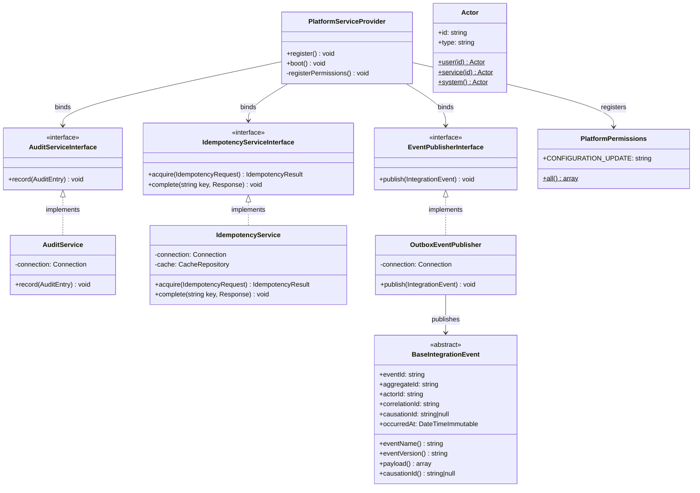

# C4 Level 4 — Code-Level Example (Platform Module)

> FR-161 requires C4 diagrams at all four levels. At the code level, full class diagrams for
> all 9 modules would be prohibitively large. This document illustrates the code-level pattern
> using the Platform module (the only fully implemented module in Platform Foundation).
> Domain epic implementations (E01–E34) are responsible for providing their own code-level
> diagrams as part of each epic's documentation.

---

## Platform Module: Key Class Relationships



---

## Request Lifecycle (code-level sequence)

```mermaid
sequenceDiagram
    participant Client
    participant CorrelationIdMiddleware
    participant IdempotencyMiddleware
    participant Controller
    participant ApplicationService
    participant OutboxEventPublisher
    participant PostgreSQL

    Client->>CorrelationIdMiddleware: POST /v1/resource (Idempotency-Key: X)
    CorrelationIdMiddleware->>IdempotencyMiddleware: adds X-Correlation-ID header
    IdempotencyMiddleware->>PostgreSQL: SELECT FOR UPDATE SKIP LOCKED on idempotency_records
    alt key already completed
        PostgreSQL-->>IdempotencyMiddleware: existing response
        IdempotencyMiddleware-->>Client: 200 (cached response)
    else key in progress
        PostgreSQL-->>IdempotencyMiddleware: locked row
        IdempotencyMiddleware-->>Client: 409 IDEMPOTENCY_IN_PROGRESS
    else new key
        IdempotencyMiddleware->>Controller: proceeds
        Controller->>ApplicationService: invoke domain logic
        ApplicationService->>PostgreSQL: BEGIN; domain INSERT + outbox INSERT; COMMIT
        PostgreSQL-->>ApplicationService: committed
        ApplicationService-->>Controller: result
        Controller-->>Client: 201 success
    end
```

---

## Notes

- Code-level diagrams for Identity, Wallet, Ledger, KYC, Transaction, Risk, Agent, and Notification modules are deferred to each epic's implementation documentation.
- All class diagrams MUST be updated when module implementations change.
- Diagrams use Mermaid syntax and are rendered in GitHub/GitLab markdown.
