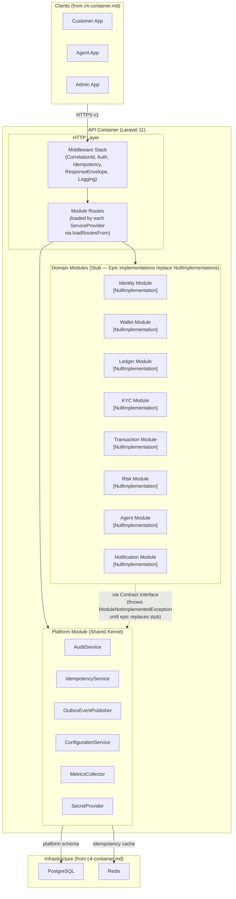

# C4 Level 3 — Component Diagram (API Container)

> This diagram shows the components inside the API container (Laravel modular monolith).
> Each component is a bounded module with an explicit public contract interface.



## Module Public Contracts

Each domain module exposes a typed PHP interface as its public boundary. Cross-module calls MUST use these contracts — never direct namespace imports.

| Module | Contract Interface | Status |
|--------|-------------------|--------|
| Platform | `AuditServiceInterface`, `IdempotencyServiceInterface`, `EventPublisherInterface`, `ConfigurationServiceInterface` | Implemented |
| Identity | `IdentityModuleContract` | Stub (NullImplementation) |
| Wallet | `WalletModuleContract` | Stub (NullImplementation) |
| Ledger | `LedgerModuleContract` | Stub (NullImplementation) |
| KYC | `KycModuleContract` | Stub (NullImplementation) |
| Transaction | `TransactionModuleContract` | Stub (NullImplementation) |
| Risk | `RiskModuleContract` | Stub (NullImplementation) |
| Agent | `AgentModuleContract` | Stub (NullImplementation) |
| Notification | `NotificationModuleContract` | Stub (NullImplementation) |

See `specs/999-platform-foundation/contracts/module-contracts.md` for contract method signatures.

## Module Directory Structure (per module)

```
app/Modules/{Module}/
├── Domain/
│   ├── Contracts/          # Public interface (consumed by other modules)
│   ├── Events/             # Integration event classes
│   ├── ValueObjects/
│   └── Permissions/        # Permission constant registry
├── Application/
│   └── Services/           # Orchestration — domain logic, no HTTP concern
├── Infrastructure/
│   ├── Migrations/         # Module's PostgreSQL schema (named connection)
│   ├── NullImplementations/ # Stub until epic replaces with real impl
│   └── Repositories/       # Data access — module's named connection only
└── Providers/
    └── {Module}ServiceProvider.php  # Registers bindings, loads routes/migrations
```
