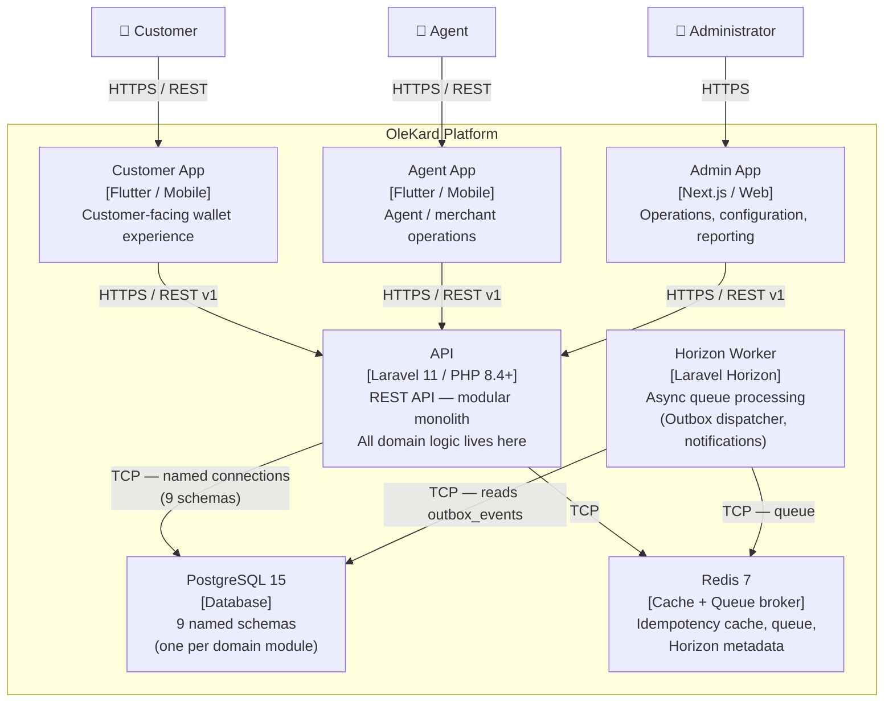

# C4 Level 2 — Container Diagram

> This diagram shows the containers (independently deployable units) that make up the OleKard platform.

## Container Descriptions

| Container | Technology | Responsibility |
|-----------|-----------|----------------|
| Customer App | Flutter (Dart) | Customer wallet: balance, transfers, history, KYC |
| Agent App | Flutter (Dart) | Agent operations: cash-in, cash-out, commissions |
| Admin App | Next.js + TypeScript | Platform administration: configuration, risk, reporting |
| API | Laravel 11 / PHP 8.4+ | All domain logic, REST API, module boundaries enforced here |
| Horizon Worker | Laravel Horizon | Processes job queues: outbox dispatch, async notifications |
| PostgreSQL 15 | PostgreSQL | Durable storage — 9 module schemas, financial source of truth |
| Redis 7 | Redis | Queue broker, idempotency read cache, Horizon metadata |

## Notes

- Redis is **never** the source of financial truth. All financial data is authoritative in PostgreSQL.
- The API container hosts all 9 domain modules as bounded namespaces within the same process during Platform Foundation. Extraction to independent services requires only changing connection host environment variables (see ADR-003).
- See `c4-component.md` for the internal structure of the API container.
