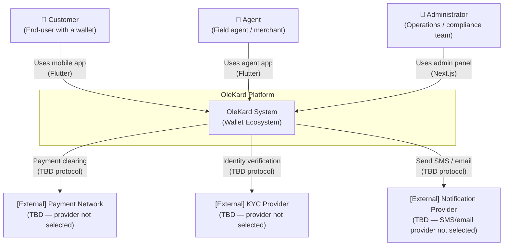

# C4 Level 1 — System Context Diagram

> This diagram shows the OleKard system in the context of its users and external systems.
> External system names are placeholders — provider selection is TBD (Constitution Principle 2).

## Notes

- External provider connections are shown as placeholders. No URLs, credentials, or provider names are specified here — those are operational configuration values.
- The OleKard system boundary contains all containers described in `c4-container.md`.
