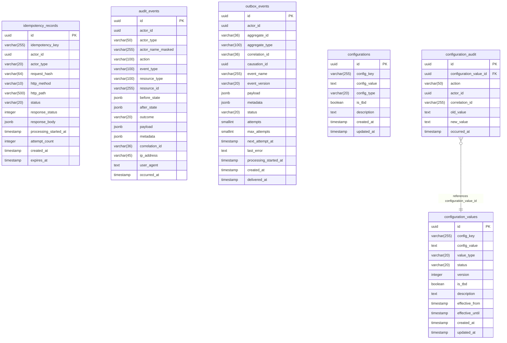
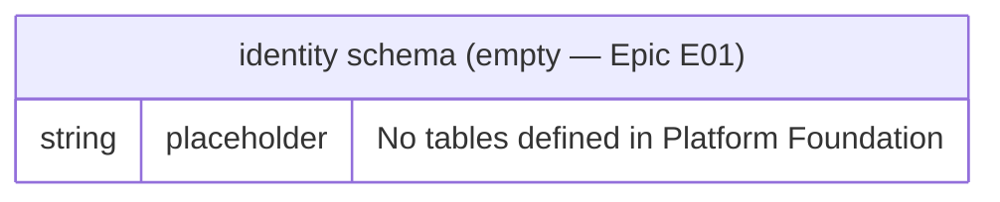
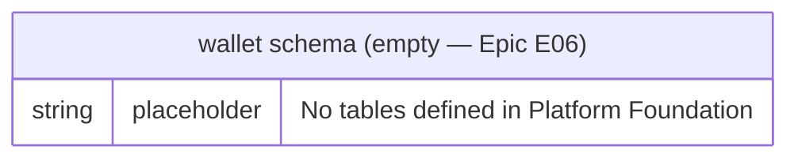
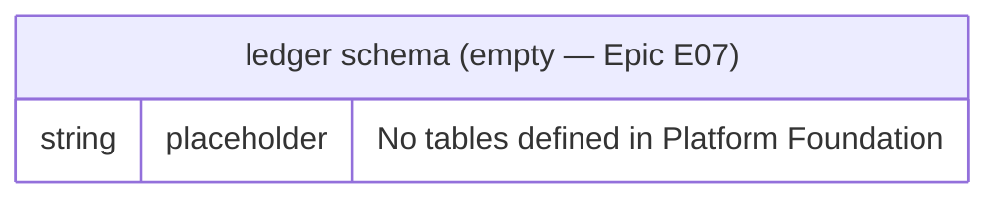
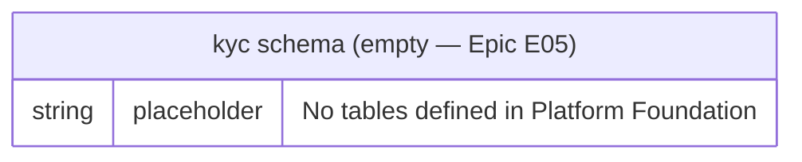
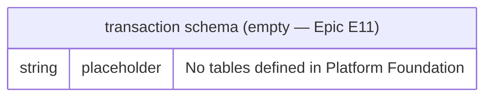
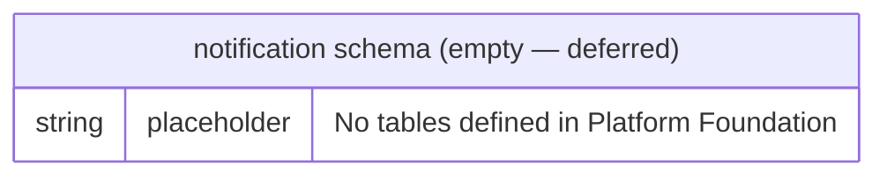

# Database Entity-Relationship Diagrams

> **Source of truth**: These diagrams are derived from the migration files in each module's
> `Infrastructure/Migrations/` directory. When migrations change, this document MUST be updated.
>
> **Cross-schema FK rule**: No FK relationships exist across module schemas (FR-002). Dotted reference
> lines below indicate logical associations documented here for readability only — they are NOT
> enforced by the database.
>
> **UUID v7**: All `id` primary keys are UUID v7 (`uuid` type in Laravel migrations, stored as
> `uuid` in PostgreSQL).

---

## `platform` Schema

The Platform module is the only fully implemented schema in Platform Foundation.
It contains 6 tables across 7 migrations (the first migration creates all 9 schemas).

### Platform Schema Indexes

| Table | Index | Columns | Type |
|-------|-------|---------|------|
| `idempotency_records` | `idempotency_records_actor_key_unique` | `(actor_id, idempotency_key)` | UNIQUE |
| `idempotency_records` | `idempotency_records_status_idx` | `status` | INDEX |
| `idempotency_records` | `idempotency_records_processing_started_at_idx` | `processing_started_at` | INDEX |
| `audit_events` | `audit_events_actor_occurred_at_idx` | `(actor_id, occurred_at)` | INDEX |
| `audit_events` | `audit_events_resource_idx` | `(resource_type, resource_id)` | INDEX |
| `audit_events` | `audit_events_action_idx` | `action` | INDEX |
| `audit_events` | `audit_events_event_type_idx` | `event_type` | INDEX |
| `outbox_events` | `outbox_events_dispatch_idx` | `(status, next_attempt_at)` | INDEX |
| `outbox_events` | `outbox_events_aggregate_idx` | `(aggregate_id, event_name)` | INDEX |
| `outbox_events` | `outbox_events_stuck_idx` | `(status, processing_started_at)` | INDEX |
| `outbox_events` | `outbox_events_correlation_idx` | `correlation_id` | INDEX |
| `configurations` | `configurations_config_key_unique` | `config_key` | UNIQUE |
| `configuration_values` | `configuration_values_key_version_unique` | `(config_key, version)` | UNIQUE |
| `configuration_values` | `configuration_values_key_status_from_idx` | `(config_key, status, effective_from)` | INDEX |
| `configuration_values` | `configuration_values_status_from_idx` | `(status, effective_from)` | INDEX |
| `configuration_audit` | `configuration_audit_value_id_idx` | `configuration_value_id` | INDEX |
| `configuration_audit` | `configuration_audit_occurred_at_idx` | `occurred_at` | INDEX |

### Immutability Notes

- `audit_events`: Application role has INSERT + SELECT only. UPDATE and DELETE are revoked at the database level (post-migration DBA step documented in the migration file).
- `configuration_audit`: UPDATE and DELETE are revoked via `REVOKE UPDATE, DELETE ON platform.configuration_audit FROM wallet_app` in the migration.

---

## `identity` Schema

> **Migrations deferred** — No migrations exist in `app/Modules/Identity/Infrastructure/Migrations/`.
> Tables will be defined when Epic E01 (Identity Management) is implemented.

---

## `wallet` Schema

> **Migrations deferred** — No migrations exist in `app/Modules/Wallet/Infrastructure/Migrations/`.
> Tables will be defined when Epic E06 (Wallet Management) is implemented.

---

## `ledger` Schema

> **Migrations deferred** — No migrations exist in `app/Modules/Ledger/Infrastructure/Migrations/`.
> Tables will be defined when Epic E07 (Ledger) is implemented.

---

## `kyc` Schema

> **Migrations deferred** — No migrations exist in `app/Modules/Kyc/Infrastructure/Migrations/`.
> Tables will be defined when Epic E05 (KYC) is implemented.

---

## `transaction` Schema

> **Migrations deferred** — No migrations exist in `app/Modules/Transaction/Infrastructure/Migrations/`.
> Tables will be defined when Epic E11 (Transaction) is implemented.

---

## `risk` Schema

> **Migrations deferred** — No migrations exist in `app/Modules/Risk/Infrastructure/Migrations/`.
> Tables will be defined when the Risk epic is implemented.

---

## `agent` Schema

> **Migrations deferred** — No migrations exist in `app/Modules/Agent/Infrastructure/Migrations/`.
> Tables will be defined when the Agent epic is implemented.

---

## `notification` Schema

> **Migrations deferred** — No migrations exist in `app/Modules/Notification/Infrastructure/Migrations/`.
> Tables will be defined when the Notification epic is implemented.

---

## Schema Summary

| Schema | Named Connection | Tables (Platform Foundation) | Defined by Epic |
|--------|-----------------|------------------------------|-----------------|
| `platform` | `platform` | idempotency_records, audit_events, outbox_events, configurations, configuration_values, configuration_audit | Platform Foundation (complete) |
| `identity` | `identity` | — | E01 |
| `wallet` | `wallet` | — | E06 |
| `ledger` | `ledger` | — | E07 |
| `kyc` | `kyc` | — | E05 |
| `transaction` | `transaction` | — | E11 |
| `risk` | `risk` | — | Risk Epic |
| `agent` | `agent` | — | Agent Epic |
| `notification` | `notification` | — | Notification Epic |

All schemas are created by `2026_08_01_000001_create_all_schemas.php` (Platform module migration 1).
No cross-schema foreign key constraints exist — cross-module data access uses application-layer contracts only (FR-002).
